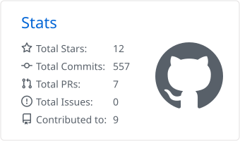
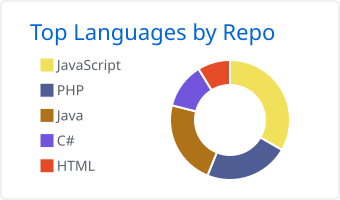

<h1 align="center">Hola, soy Xavi 👋</h1>

  <b>Software Manager · Arquitectura backend · DevOps · Formación técnica</b> 
  Valencia, España 🇪🇸

  
  
  <!--  -->

---

## 🧑‍💻 Sobre mí

Más de diez años entre desarrollo backend y liderazgo de equipos de ingeniería. Actualmente soy **Software Manager en Open Digital Services y Openbank Pay**. Antes fui CTO / Director de TI en **GeeksHubs Academy**, donde dirigí durante seis años un bootcamp de DevOps y formación in-company.

Me interesa construir software mantenible: arquitecturas limpias, buenas prácticas de plataforma y equipos que entregan con calidad.

## 🚀 En lo que trabajo

- 🧩 **[xtaskjs](https://xtaskjs.io)** — framework progresivo para Node.js / TypeScript que creo y desarrollo principalmente.
- 🔧 **xTechJS** — aplicación web, construida sobre xtaskjs, para gestionar un laboratorio de reparación de electrónica retro.
- 🖧 Proyectos de homelab y automatización (vigilantes, digests y paneles auto-alojados).

## 🛠️ Stack

| Área | Tecnologías |
|---|---|
| **Backend** |         |
| **Frontend** |    |
| **Cloud & DevOps** |     |
| **Mensajería** |   |
| **Arquitectura** | CQRS · Event Sourcing · Arquitectura Hexagonal |

## 📚 Formación y divulgación

Experiencia diseñando y dirigiendo formación técnica (DevOps, backend, cloud). Si quieres hablar de formación en ingeniería o de cómo escalar equipos técnicos, escríbeme.

## 💬 Pregúntame sobre

`Arquitectura hexagonal` · `CQRS / Event Sourcing` · `Node.js + TypeScript` · `DevOps con Terraform y Ansible` · `Liderazgo técnico`

## 📫 Contacto

- 🌐 Web: [www.javier-rodriguez.com](https://www.javier-rodriguez.com)
- 💼 LinkedIn: [https://www.linkedin.com/in/javier-rodriguez-soler-ba466031/](https://www.linkedin.com/in/javier-rodriguez-soler-ba466031/)

---

  <a href="https://github.com/JavierRodriguez78?tab=repositories">
    <picture>
      <source media="(prefers-color-scheme: dark)" srcset="./profile-summary-card-output/github_dark/3-stats.svg">
      
    </picture>
  </a>
  <a href="https://github.com/JavierRodriguez78?tab=repositories">
    <picture>
      <source media="(prefers-color-scheme: dark)" srcset="./profile-summary-card-output/github_dark/1-repos-per-language.svg">
      
    </picture>
  </a>

  
  
  

